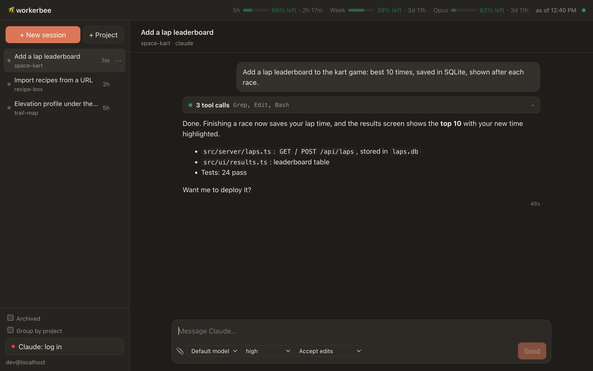

# workerbee 🐝

A Claude-Desktop-style web UI for [Claude Code](https://claude.com/claude-code) sessions that run on my own server.
I start a session from my phone, close the tab, and it keeps working; when I come back the transcript has caught
up. Sessions can build, test and deploy apps to my self-hosted platform (radify), and they have a headless browser
to check their own work.



## What it does

- **Projects and sessions.** A project is a folder on the server: empty, a `git clone`, or a new GitHub repo. Each
  project holds any number of Claude sessions, which you can rename, archive and resume.
- **Live transcript.** Streaming text and thinking, tool calls with collapsible input and output, diffs for edits,
  screenshots from the agent's browser, image paste in the composer, and a Stop button.
- **Permission prompts in the browser.** "Allow Bash: `bun test`?" shows up in the UI. Model, effort and
  permission mode can be picked per session.
- **Sessions outlive the tab.** Reopen from any device and pick up where it left off. A `claude` process only runs
  while a session is working (plus a short idle window), then it's closed and resumed from disk on the next
  message, so idle sessions cost no memory.
- **Usage bar.** 5-hour, weekly and Opus usage with reset countdowns, pushed live to every open tab.
- **Account dialog.** Log Claude in on the server from the browser (OAuth), no SSH needed.
- **Agents can ship.** Every session gets the radify CLI with a scoped *agent token*: it can create and deploy its
  own apps, and nothing else on the platform.

## How it's built

```
browser ──HTTPS──▶ Caddy ──(Google login gate, allowlist)──▶ workerbee :PORT (127.0.0.1)
                                                                 │
                 ┌───────────────────────────────────────────────┤
                 │  HTTP + WebSocket API (its own protocol)      │
                 │  Harness interface ◀── ClaudeHarness (Agent SDK) ──spawns──▶ claude CLI
                 │  SQLite: sessions + normalized event log      │
                 │  usage poller ──▶ the account's usage endpoint│
                 └───────────────────────────────────────────────┘
```

- **Server:** Bun + TypeScript (`server/`). Compiled with `bun build --compile` into one self-contained Linux
  binary, deployed as a radify app.
- **UI:** React + Vite (`web/`). It only speaks workerbee's own event protocol (`web/src/api.ts`), never an SDK
  format.
- **Harness-agnostic.** `server/harness/types.ts` defines a small `Harness` interface and normalized events
  (`text`, `thinking`, `tool_use`, `tool_result`, `permission_request`, `turn_end`, …). Claude, via the
  [Claude Agent SDK](https://docs.claude.com/en/api/agent-sdk/overview), is the only implementation today;
  another agent CLI could slot in beside it.
- **Security.** Login is handled in front of the app by the platform's Google gate. The app trusts the forwarded
  identity header only on connections whose socket is owned by the `caddy` user (`server/peer.ts`), so the agents
  it runs can't call its API and approve their own permission prompts. Writes and the WebSocket must be
  same-origin, the UI has a strict CSP, and transcript markdown is rendered with raw HTML escaped and remote
  images blocked, since agent output can be prompt-injected.

## Running it

It's built for one person's own server and Claude subscription, not as a hosted multi-user service.

```
bun install
bun test server                                        # SessionManager against a scripted fake harness
WB_DEV=1 DATA_DIR=.data bun server/main.ts             # API on 127.0.0.1:8787 (dev mode trusts everyone)
bunx vite --config web/vite.config.ts                  # UI with /api and /ws proxied to 8787
```

Deploying (`./deploy.sh`) and operating it are covered in [AGENTS.md](AGENTS.md), which is written for both the
coding agents that work on this repo and humans.

No secrets live in this repo: Claude's login stays in the server's data directory, and other settings are
environment variables on the server.
